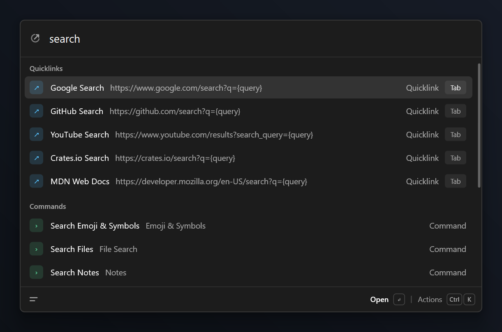
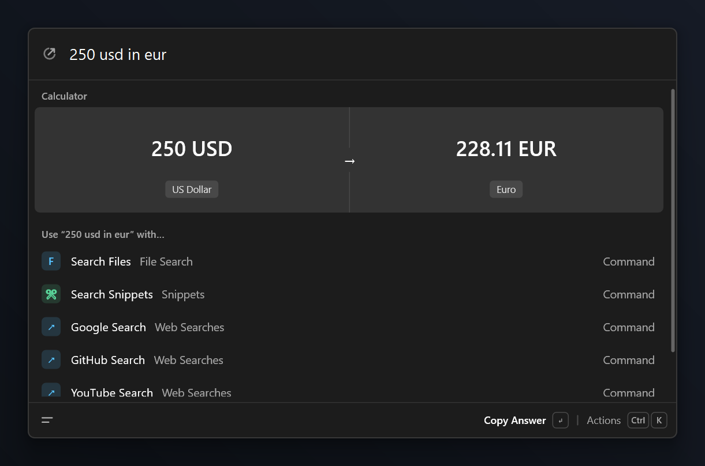
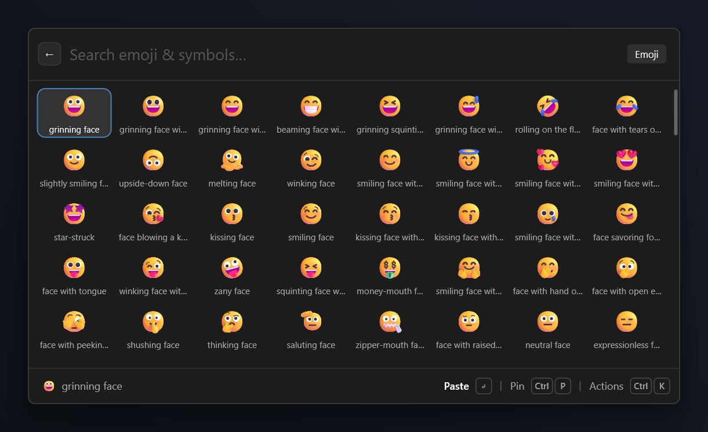
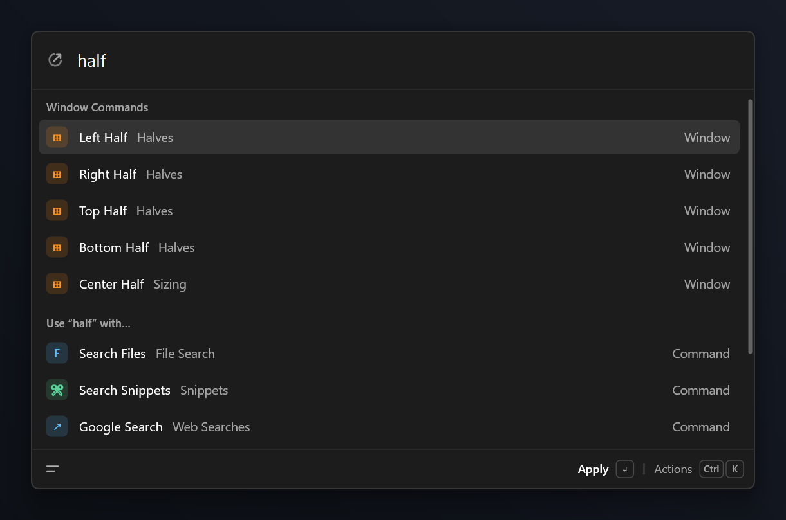

<p align="center">
  
</p>

<h1 align="center">YAL</h1>

<p align="center">
  <strong>A fast, pure-Rust Win32 + Direct2D keyboard launcher for Windows 10 and 11.</strong><br/>
  No Electron. No WebView2. No Node runtime. Single native binary.
</p>

<p align="center">
  <a href="https://github.com/Abinanthan-CG/yal/releases/latest"></a>
  <a href="LICENSE"></a>
  
  
</p>

<p align="center">
  
</p>

---

**YAL** (*Yet Another Launcher*) is a fast, lightweight native Windows keyboard launcher
built in pure Rust on Win32, Direct2D, DirectWrite, and SQLite.

Press one key, type what you want, press <kbd>Enter</kbd>. YAL finds the app,
file, calculation, clipboard entry, snippet, emoji, window, or setting you meant
in milliseconds and puts it in front of you.

```text
Alt + Space       Open / toggle the palette
Ctrl + Space      Alternative open shortcut
↓ (Compact mode)  Unfold suggestions without leaving the keyboard
Ctrl + K          Open contextual Action Panel for any item
Ctrl + I          Toggle Master-Detail info & preview pane
Tab / Shift+Tab   Fill inline Quicklink arguments or drill into folders
```

---

## Screenshots

<table>
  <tr>
    <td width="50%" align="center">
      <br/>
      <sub><strong>Swiss-Army Calculator</strong> — live currency, unit, date &amp; expression hero cards</sub>
    </td>
    <td width="50%" align="center">
      <br/>
      <sub><strong>2D Color Emoji Picker</strong> — hardware-accelerated DirectWrite color emoji grid</sub>
    </td>
  </tr>
  <tr>
    <td width="50%" align="center">
      <br/>
      <sub><strong>Window Management</strong> — 40 native snap, tile, center &amp; display-move commands</sub>
    </td>
    <td width="50%" align="center">
      <br/>
      <sub><strong>Quicklinks &amp; Commands</strong> — inline <code>Tab</code> arguments, aliases &amp; frecency ranking</sub>
    </td>
  </tr>
</table>

---

## Features (v1.0.0)

- **Native Win32 + Direct2D UI:** Hardware-accelerated rendering with Windows 11 rounded corners, native shadows, per-monitor DPI scaling, automatic Dark & Light themes, and **Compact** (single search pill) or **Expanded** window mode.
- **Instant App & Command Search:** Indexes Start Menu, App Paths, registry uninstall entries, and Microsoft Store / MSIX apps with real extracted Windows icons, frecency learning, favorites (`Ctrl+1..0`), and per-command hotkeys & aliases.
- **Fast Local File Search:** Background SQLite WAL + FTS5 trigram index across your user folders with a live overlapped Win32 `FileWatcher`, type filters, folder drill-down (`Tab`), preview pane (`Ctrl+I`), Reveal in Explorer, and Recycle Bin support.
- **Swiss-Army Calculator:** Live arithmetic, units & compound measures, 159 fiat + 23 crypto currencies (live FX), DST-aware world clocks & date countdowns (`hours till 27 nov`, `days between ...`), variables & `ans`, color space transforms (`#hex` / `rgb` / `hsl`), statistics, finance, chemistry, and Calculator History.
- **Rich Clipboard History & Paste Queue:** Captures text, links, emails, color swatches, files, and images with pinning, filtering, preview, and sequential `Paste Queue` (`Paste Next`).
- **Snippets & Auto-Expansion:** Markdown-backed snippets with `{clipboard}`, `{selection}`, `{date}`, `{time}`, `{uuid}`, `{cursor}`, `{argument}`, and nested `{snippet:...}` templates, plus background `!keyword` auto-expansion and Raycast snippet import.
- **2D Color Emoji & Symbol Picker:** Full searchable DirectWrite color emoji grid with frequent recents and pinning.
- **Window Management & Switcher:** 40 native window tiling/snapping commands (halves, thirds, quarters, sixths, center, display moves, undo) plus live open-window switching.
- **Quicklinks, Quick Notes & Fallback Search:** Parameterized `{query}` Quicklinks with inline `Tab` argument pills, persistent Quick Notes, and always-on `Use "<query>" with...` fallback search commands.
- **Custom Commands & Shell Runner:** PowerShell, `cmd`, Git Bash, and WSL script commands running inside Win32 Job Objects, plus Raycast script-command import.
- **Power-User Input & Backup:** Optional `CapsLock` Hyperkey, live hotkey recorder, 64 built-in Settings, `tinycast://` deep links, and SHA-256 verified backup & restore.

---

## Installing

### Per-user installer (recommended)

Download `yal-setup-1.0.0-x64.exe` (or `-arm64.exe`) from the
[Releases page](https://github.com/Abinanthan-CG/yal/releases) and run it.

- Installs **per user** (`%LOCALAPPDATA%\Programs\yal`) — never asks for administrator rights.
- Offers optional Start Menu shortcut, Desktop shortcut, and Launch at Login.
- Registers the `tinycast://` link protocol for your user account only.
- Cleanly uninstallable from *Settings → Apps → Installed apps* while preserving your data in `%APPDATA%\yal` unless you choose to remove it.

### Scoop

This repository serves directly as a Scoop bucket (supports both `x64` and `arm64`):

```powershell
scoop bucket add yal https://github.com/Abinanthan-CG/yal
scoop install yal/yal
```

### Portable build

Download `yal-1.0.0-x64-portable.zip` (or `-arm64-portable.zip`), extract it anywhere, and run `yal.exe`.

Verify any release download against `SHA256SUMS.txt`:

```powershell
Get-FileHash .\yal-setup-1.0.0-x64.exe -Algorithm SHA256
```

### WinGet manifest

Validated multi-file WinGet manifests (`Abinanthan-CG.YAL`, schema `1.12.0`) live under
[`packaging/winget/manifests/a/Abinanthan-CG/YAL/1.0.0/`](packaging/winget/manifests/a/Abinanthan-CG/YAL/1.0.0/)
for local manifest testing (`winget install --manifest ...`) and submission to `microsoft/winget-pkgs`.

---

## Building from source

Requires the pinned Rust toolchain (`rust-toolchain.toml`, MSRV `1.89`) and [NSIS](https://nsis.sourceforge.io/) if building the installer.

```powershell
git clone https://github.com/Abinanthan-CG/yal.git
cd YAL
cargo build --release --bin yal
.\target\release\yal.exe --self-test
```

To build the release installer, portable zip, and `SHA256SUMS.txt`:

```powershell
cargo run --quiet -p xtask -- dist --arch x64
```

Artifacts are written to `dist/`. Full build notes live in [`docs/BUILD.md`](docs/BUILD.md).

---

## Repository layout

```text
crates/
  tc-core/          commands, launcher rows, deeplinks, identifiers
  tc-search/        fuzzy matching, folding, scoring, frecency ranking
  tc-apps/          Start Menu, registry, App Paths & MSIX app discovery
  tc-calc/          calculator engine (units, FX, dates, timezones, colors, finance)
  tc-clipboard/     clipboard history model, classification, paste queue & SQLite store
  tc-emoji/         color emoji catalog, search & favorites
  tc-snippets/      Markdown snippet library, template engine & Raycast import
  tc-files/         SQLite WAL + FTS5 trigram file indexer & scoped search
  tc-windows/       40 window-tiling commands & multi-monitor geometry
  tc-commands/      built-in command catalog, custom commands & Job Object shell runner
  tc-backup/        SHA-256 verified export/restore & Raycast import
  tc-palette/       screen stack, key chords, settings schema & compact/expanded policy
  tc-platform/      platform traits and deterministic test fakes
  tc-platform-win/  Win32 hotkeys, Hyperkey, snippet expander, clipboard, icons & FileWatcher
  tc-ui/            pure Win32 + Direct2D + DirectWrite palette renderer & HUD
apps/
  yal/              single-binary Windows launcher (palette, tray, hotkeys, single instance)
  yal-ui-probe/     standalone Direct2D layout & render probe
assets/             official Launch Ring SVG (`yal.svg`, `yal-mark.svg`), PNG, ICO & screenshots
bucket/             live Scoop bucket manifest (`yal.json`)
installer/          per-user NSIS installer script (`yal.nsi`)
packaging/          WinGet multi-file manifests & templates, Scoop manifest template
xtask/              release packaging (`dist`) and self-test orchestration
```

---

## Licence & Attribution

Licensed under **AGPL-3.0-only** — see [`LICENSE`](LICENSE) and [`NOTICE.md`](NOTICE.md).
Portions of YAL's domain logic are derived from [Tinycast](https://github.com/abue-ammar/tinycast)
(AGPL-3.0); YAL is an independent project and is not affiliated with or endorsed by Tinycast.

## Documentation

- [`docs/BUILD.md`](docs/BUILD.md) — building from source & running smoke tests
- [`docs/SHORTCUTS.md`](docs/SHORTCUTS.md) — keyboard shortcuts reference
- [`docs/ARCHITECTURE.md`](docs/ARCHITECTURE.md) — workspace architecture & crate map
- [`.github/CONTRIBUTING.md`](.github/CONTRIBUTING.md) & [`.github/SECURITY.md`](.github/SECURITY.md) — contributing & security policy

### Privacy

YAL has no accounts, no telemetry, and no analytics. Network calls happen only when you
explicitly use live currency exchange rates or open external URLs/Quicklinks.
